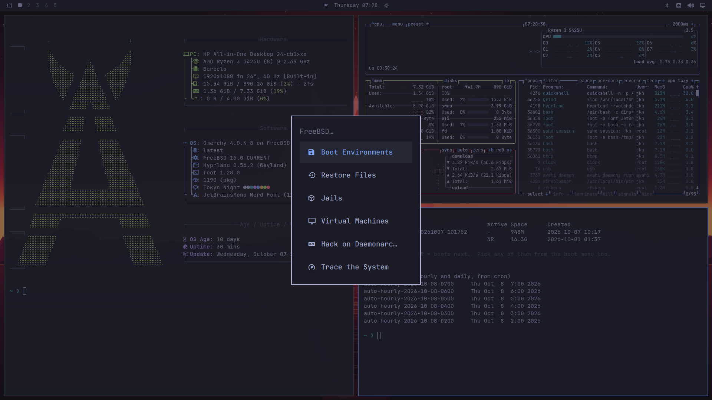
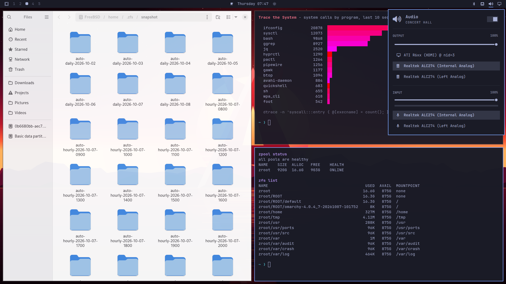
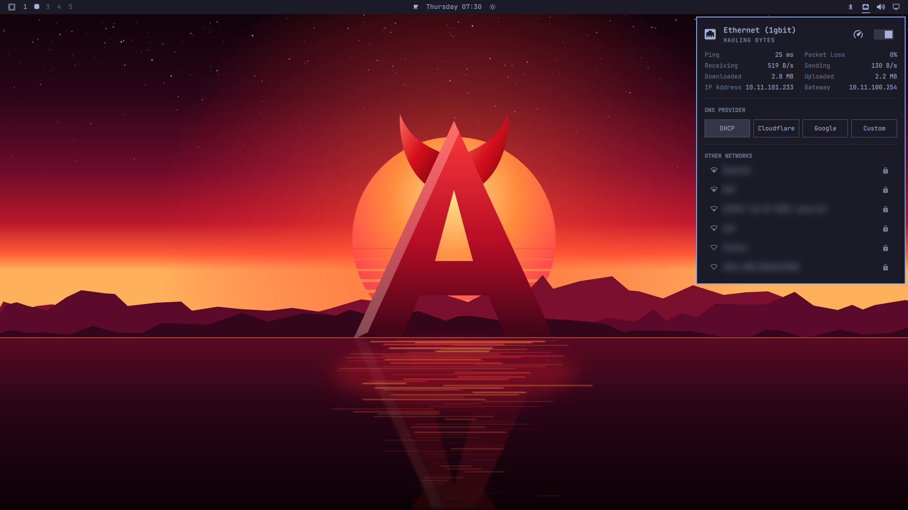

# Daemonarchy



Daemonarchy is the [Omarchy](https://omarchy.org) desktop on FreeBSD: DHH's opinionated Hyprland desktop, ported to FreeBSD and installed the way the Omarchy ISO installs it on Arch. The name is a homage: Omarchy's *-archy*, ruled by the BSD daemon.

You write an image to a USB stick, boot it, answer the questions Omarchy's own installer asks (keyboard, account, hostname, time zone) plus the few that are FreeBSD's own (network, disk), and once the packages have downloaded you are looking at a tiled Wayland desktop with a real FreeBSD underneath it: ZFS, boot environments, jails, bhyve, DTrace, `pkg`. Daemonarchy is not affiliated with Omarchy; the Omarchy software itself comes, unchanged apart from FreeBSD compatibility, from the `x11-wm/omarchy` port.

Each release is built from a FreeBSD 16.0-CURRENT snapshot. CURRENT moves daily, so an image is tied to the snapshot it was built from.

## Which page do I need?

| I want to... | Read |
|---|---|
| Install it and use it | This page, then the [getting-started guide](docs/getting-started.md), which walks through the first hour on the desktop |
| Know what is the same as FreeBSD and what is different | [Is it still FreeBSD?](#is-it-still-freebsd) below |
| Change it, build an image, build one port, build FreeBSD "the Daemonarchy way", or cut a release | [HACKING.md](HACKING.md) |
| Know what the project is aiming at | [PROJECT.md](PROJECT.md), the [active work queue](docs/roadmap/active-work.md) and the [architecture](docs/architecture/design-traceability.md) |
| Know what changed in each release | [CHANGELOG.md](CHANGELOG.md) |

## Download

The latest stable release is **[Daemonarchy 1.5.1](https://github.com/jordanhubbard/daemonarchy/releases/tag/daemonarchy-1.5.1)** (x86-64, BIOS or UEFI, and a community-validation arm64 image), published November 7, 2026, on FreeBSD 16.0-CURRENT, OSVERSION `1600029`. Version 1.2.0 was not published; 1.3.1 followed 1.1.1, 1.4.0 followed 1.3.1, 1.4.1 followed 1.4.0, 1.5.0 followed 1.4.1 and 1.5.1 follows 1.5.0.

- [x86-64 ISO, xz-compressed](https://github.com/jordanhubbard/daemonarchy/releases/download/daemonarchy-1.5.1/daemonarchy-1.5.1-amd64.iso.xz): 1,593,471,020 bytes.
- [x86-64 checksum](https://github.com/jordanhubbard/daemonarchy/releases/download/daemonarchy-1.5.1/daemonarchy-1.5.1-amd64.iso.xz.sha256) of the compressed file: `de9311416cf29c88525efcec0dcae3990c38cbffe8235035b50b3a8e4d1b84ad`.
- [arm64 ISO, xz-compressed](https://github.com/jordanhubbard/daemonarchy/releases/download/daemonarchy-1.5.1/daemonarchy-1.5.1-aarch64.iso.xz): 958,315,864 bytes, UEFI only. **This is a community-validation image:** it was verified to boot and install in QEMU and nothing more. The NVIDIA RTX Spark laptop is tested but not yet working (support is deferred); no other physical aarch64 hardware was tested. See [aarch64](docs/aarch64.md) and the [Spark application note](docs/application-note-rtx-spark.md).
- [arm64 checksum](https://github.com/jordanhubbard/daemonarchy/releases/download/daemonarchy-1.5.1/daemonarchy-1.5.1-aarch64.iso.xz.sha256) of the compressed file: `42106836374a3c15116de7d8569dae66a4ddc11ffd595aecc5dfc3f6485d38b6`.
- [amd64 hardware bring-up trace image, xz-compressed](https://github.com/jordanhubbard/daemonarchy/releases/download/daemonarchy-1.5.1/daemonarchy-hwtrace-1.5.1-amd64.img.xz): 20,069,016 bytes, for machines that fail early in kernel start ([how to use it](docs/boottrace.md)).
- [amd64 trace image checksum](https://github.com/jordanhubbard/daemonarchy/releases/download/daemonarchy-1.5.1/daemonarchy-hwtrace-1.5.1-amd64.img.xz.sha256) of the compressed file: `89a2769413c1262050b167bd16b9fdd49e7db20f92daa1c6b635b6e2915cfe98`.
- [arm64 hardware bring-up trace image, xz-compressed](https://github.com/jordanhubbard/daemonarchy/releases/download/daemonarchy-1.5.1/daemonarchy-hwtrace-1.5.1-aarch64.img.xz): 15,046,456 bytes; its [checksum](https://github.com/jordanhubbard/daemonarchy/releases/download/daemonarchy-1.5.1/daemonarchy-hwtrace-1.5.1-aarch64.img.xz.sha256) of the compressed file is `63e6f5fee9cb0d393afb0c059bc051651c0af735778214310a2e864ed9b03ce1`.
- The release also carries the signed Secure Boot bundle (`daemonarchy-1.5.1-boot.txz` and its `.sig`, amd64 only) and the public certificate in PEM and DER form.
- Read the [1.5.1 release notes](docs/release-1.5.1.md) and their hardware status and limits before installing. Wi-Fi and Hyprland are not guaranteed on any particular machine.

## From download to desktop

You need a 64-bit x86 PC (UEFI or legacy BIOS), a USB stick of 4 GB or more (the image is 3.5 GB once decompressed, and writing it erases the stick), a disk or free region of 40 GB or more, and a network connection during the install, because the desktop's roughly 1,200 packages are downloaded then rather than carried on the stick. The [getting-started guide](docs/getting-started.md) has the long version with pictures; this is the short one.

1. **Check the download** (optional, quick). Put the `.iso.xz` and its `.sha256` in one folder and run `sha256sum -c daemonarchy-*.iso.xz.sha256` on Linux, `shasum -a 256 -c daemonarchy-*.iso.xz.sha256` on macOS, or `Get-FileHash` in PowerShell and compare by eye. The checksum covers the compressed file you downloaded. If it says `OK`, the bytes are the ones in the release.
2. **Write it to the stick.** The image is copied byte for byte, so dragging the file onto the stick does nothing useful. [balenaEtcher](https://etcher.balena.io) flashes the `.iso.xz` directly. With `dd`, find the stick first (`lsblk` on Linux, `diskutil list` on macOS) and be sure of the device name, because `dd` overwrites whatever you point it at: `xz -dc daemonarchy-1.5.1-amd64.iso.xz | sudo dd of=/dev/sdX bs=1M status=progress conv=fsync` on Linux (on macOS use `bs=1m` and the `/dev/rdiskN` name that `diskutil list` shows).
3. **Boot from it.** Press your machine's boot-menu key at power-on (often F12, F11, F10 or Esc; hold Option on a Mac) and pick the stick. Turn Secure Boot off, or [enroll the project's certificate](docs/secure-boot.md) to keep it on; factory keys alone reject the project's loader. The x86-64 image shows a short FreeBSD loader menu: press **T** to try the desktop live from the stick without touching any disk, or let the countdown run to start the installer.
4. **Answer the questions.** Keyboard, your name and password, a computer name, a time zone; then the network (a plugged-in cable is usually already up; otherwise choose Join Wi-Fi) and the storage choice. Nothing is written to a disk until you confirm the summary. **Whole-disk mode erases the selected disk**; partition mode replaces only the GPT partition you select, and free-space mode uses existing free space. The installer does not shrink another system's filesystems, so make room from that system first.
5. **Wait for the success screen.** The installer lays out an EFI partition, swap and a ZFS pool (encrypted if you asked), extracts the base system, then installs the desktop with `pkg`. While it works you can play one of the four arcade games from its Extensions menu. Do not restart until it says it finished: an unexpected reboot is not a completion signal, and if something stops, the [rescue menu](docs/rescue-console.md) keeps the log.
6. **Log in.** Type your password at the login screen (an encrypted install logs straight in after you unlock the disk at boot). The first login takes a few seconds longer while your desktop is set up. **Super** (the Windows or Command key) plus **Space** opens the menu; **Super + K** lists every shortcut.

The installer can also run without a keyboard from an answers file on a second drive; see the [installer reference](docs/installer-reference.md#unattended-installs).

### The arm64 image is for adventurous people

The arm64 image is a community-validation image: it was verified to boot and install in a QEMU virtual machine and nothing more. No physical arm64 machine is known to work; the NVIDIA RTX Spark laptop boots its kernel but does not reach a desktop, and support for it is deferred. There is no live desktop, no Secure Boot bundle and no Apple silicon install target. There is one **known issue**: in QEMU with the default `virtio-net` network card the install stalls during the package fetch, because the guest stops servicing receive on `vtnet0`. Start QEMU with `-device e1000e` until this is fixed; with that card the install takes about 20 minutes and boots under UEFI. If you try it, please [open an issue](https://github.com/jordanhubbard/daemonarchy/issues) with the machine, the image checksum and what happened, whether it worked or not. The full record is in [aarch64](docs/aarch64.md).

## Is it still FreeBSD?

Yes. If you know FreeBSD you already know most of this system, and if you do not, everything you learn about it from the [FreeBSD Handbook](https://docs.freebsd.org/en/books/handbook/) applies. This section is the map of where Daemonarchy stops being stock FreeBSD.

### What is the same

- **The kernel and the base system.** Both are FreeBSD 16.0-CURRENT, built from [daemonarchy-src](https://github.com/jordanhubbard/daemonarchy-src), a fork that tracks upstream FreeBSD and keeps its source layout and build system. The installer unpacks the release's `base.txz`, `kernel.txz` and `lib32.txz`, the same kind of tarball sets FreeBSD publishes. The fork carries Daemonarchy's own changes on its integration branch (for example hardware fixes and boot diagnostics), the way any vendor tree would.
- **ZFS and the loader.** The system boots from a ZFS pool laid out the way `bsdinstall` lays one out, with the FreeBSD loader and its boot menu, and optional GELI encryption. `bectl` manages boot environments exactly as it does anywhere else.
- **`rc`, `sysrc` and `service`.** The installer enables D-Bus, seatd and the login manager through `/etc/rc.conf` like any FreeBSD service. Nothing replaces init or `rc`.
- **`pkg` and the ports.** Software is `pkg install`; the ports tree is FreeBSD's, kept in a fork ([daemonarchy-ports](https://github.com/jordanhubbard/daemonarchy-ports)) that also carries the Omarchy ports and is resubmitted upstream. Most packages on your system are FreeBSD's own, as built by pkg.FreeBSD.org.
- **Jails, bhyve, DTrace, pf and the rest** are FreeBSD's. Daemonarchy puts front ends for jails, virtual machines, boot environments, home snapshots and DTrace views in the menu under **System > FreeBSD**.
- **Optional `/usr/src` and `/usr/ports`.** The installer offers both as ordinary Git checkouts of the two forks. In them, FreeBSD's usual commands (`make buildworld`, `make buildkernel`, `make` in a port directory) are the same commands; see [HACKING.md](HACKING.md) for what Daemonarchy adds around them and what to be careful about.

### What is different

- **The installer.** Daemonarchy does not use `bsdinstall`. Its own installer asks Omarchy's questions, checks the network before it touches a disk, lays out the disk, installs, verifies the result and keeps a rescue console for when something goes wrong.
- **The desktop is preinstalled and preconfigured.** You get Hyprland, a shell bar, themes, the Omarchy menu and key bindings, SDDM, PipeWire, a FreeBSD Wi-Fi and Bluetooth panel and a curated application set, instead of a prompt.
- **Where packages come from, and who signs them.** FreeBSD's packages come from pkg.FreeBSD.org. The Omarchy ports and a few fixed packages come from Daemonarchy's own signed repository, published as GitHub release assets; the installer adds its public key at `/usr/local/etc/pkg/keys/daemonarchy.pub`. For installs, the release also hosts a signed copy of the installer's whole package closure, so a package that disappears upstream on the wrong day cannot break an install. The GPU and Wi-Fi kernel modules are built against the exact kernel of the image and stay on the image's own repository, `Daemonarchy-ISO`.
- **Updates are applications, not the base.** `pkg upgrade` (and the menu's Update, which first saves a boot environment) upgrades applications. There is no network upgrade of the base system, kernel, boot files or trust anchors yet, and no `pkgbase` feed is published; a new snapshot or kernel arrives as a new image. [The upgrade model](HACKING.md#the-upgrade-model-today) says exactly what works.
- **Secure Boot (x86-64).** The loader and kernel are signed with a project certificate you enroll by hand, with the module packages locked to a signed inventory. Stock FreeBSD does not do this.
- **Linux-only applications are withheld** until their exact versions pass Linuxulator qualification ([policy](docs/freebsd-application-policy.md)). Chromium is installed by default.
- **Diagnostics for hard hardware.** A [remote debug mode](docs/remote-agent-debug.md) in the installer, a [console rescue menu](docs/rescue-console.md) and a separate [hardware bring-up trace image](docs/boottrace.md) (`daemonarchy-hwtrace-<version>-<arch>.img`, which records each kernel start-up step in UEFI NVRAM) exist because the project is brought up on machines that do not always boot.
- **Releases are numbered on their own.** Daemonarchy uses semantic versioning independent of FreeBSD's and Omarchy's numbers, and each release is pinned to one CURRENT snapshot with its own source and ports commits.

## What FreeBSD adds

Daemonarchy is the Omarchy desktop with FreeBSD underneath, and it puts FreeBSD's strengths in the Omarchy menu under **System > FreeBSD**:

- **Boot environments.** The system lives on ZFS, and every Omarchy update first saves a boot environment: a bootable copy of the whole system. Roll back to any of them from the menu or the boot loader.
- **Restore files.** Hourly and daily ZFS snapshots of home directories, kept for a day and a week; open one in the file manager and copy back what you lost.
- **Jails.** Lightweight FreeBSD containers, each with its own FreeBSD system and packages.
- **Virtual machines.** Run Linux, Windows, or the BSDs with bhyve, FreeBSD's hypervisor.
- **Trace the system.** Live views of what the system is doing, through DTrace.
- **Hack on Daemonarchy.** Fetch the sources and run the desktop from your own checkout of Omarchy; see [HACKING.md](HACKING.md).



Omarchy's panels work on FreeBSD too. Wi-Fi runs through FreeBSD's `wpa_supplicant`, sound through PipeWire, and Bluetooth keyboards and mice through FreeBSD's own Bluetooth stack:



Install software from FreeBSD's package collection through OctoPkg (**Install > Packages**) or `pkg`. Chromium is installed by default. Linux-only applications and automatic agent downloads are withheld until their exact versions pass native Linuxulator qualification; see the [application policy](docs/freebsd-application-policy.md).

## Do I need Literate AI?

No. [Literate AI](https://github.com/jordanhubbard/literate-ai) (`litai`) is a separate project, a release-engineering tool the maintainers use to check Daemonarchy's design contracts and to record evidence about what was built and tested. It is not on the image, not in the package feeds, and nothing you do as a user (installing, updating, running the desktop, using `pkg`) calls it. Developers can build, test and release Daemonarchy without it too, with less checking; [HACKING.md](HACKING.md#literate-ai-what-it-is-and-whether-you-need-it) says what it does, where to install it and what is rough about it today.

## What the image contains

- A live FreeBSD system (from the snapshot) that logs root in on the first console and starts the installer.
- The installer: `configurator` asks the questions, `install` installs, `dashboard` shows its progress, `launch` ties them together.
- The snapshot's `base.txz`, `kernel.txz` and `lib32.txz`, which become the installed system. The 32-bit compatibility libraries also satisfy native package dependencies such as LLVM/Mesa.
- A package repository with what pkg.FreeBSD.org does not publish: the Omarchy ports from the release's ports fork ([daemonarchy-ports](https://github.com/jordanhubbard/daemonarchy-ports) `e84b4c4c` for 1.5.0), and the GPU and Wi-Fi kernel modules (`drm-612-kmod`, `gpu-firmware-*-kmod`, `wifi-firmware-*-kmod`) built for the snapshot kernel.

Other desktop dependencies are downloaded during installation. Compatible official packages come from pkg.FreeBSD.org; the release's versioned feed also supplies ordinary dependencies rebuilt for its newer ports/base selection. Network access is required. Keeping those downloads off the ISO keeps each release asset below GitHub's 2 GiB limit; a complete offline desktop payload would exceed that budget.

## Updates

The upgrade model, stated plainly: [what `pkg upgrade` does and does not do, and when an ISO is still needed](HACKING.md#the-upgrade-model-today). Developers who want to publish their own installer and feeds: [Forking Daemonarchy](HACKING.md#forking-daemonarchy).

Application packages update with `pkg upgrade` (which Omarchy's update runs). This does not update the FreeBSD base/kernel or make kernel modules compatible with another snapshot. FreeBSD's packages come from pkg.FreeBSD.org. Daemonarchy's own packages (the Omarchy ports and the patched Quickshell) come from a signed repository published as the assets of the [`packages-16-amd64`](https://github.com/jordanhubbard/daemonarchy/releases/tag/packages-16-amd64) release. The installer adds its key as `/usr/local/etc/pkg/keys/daemonarchy.pub`, so fixes reach you without a new ISO. The image's own packages stay on the disk as a fallback repository, `Daemonarchy-ISO`, since the GPU and Wi-Fi modules built for its kernel are only there.

A system installed from an image dated 2026-10-02 or earlier has only the on-disk repository. To move it to the online one, run as root:

```
mkdir -p /usr/local/etc/pkg/keys
fetch -o /usr/local/etc/pkg/keys/daemonarchy.pub https://raw.githubusercontent.com/jordanhubbard/daemonarchy/main/overlay/usr/local/share/daemonarchy-installer/daemonarchy.pub
cat >/usr/local/etc/pkg/repos/Daemonarchy.conf <<'EOF'
Daemonarchy: {
  url: "https://github.com/jordanhubbard/daemonarchy/releases/download/packages-16-amd64",
  signature_type: "pubkey",
  pubkey: "/usr/local/etc/pkg/keys/daemonarchy.pub",
  priority: 10,
  enabled: yes
}
Daemonarchy-ISO: {
  url: "file:///var/db/daemonarchy/repo",
  signature_type: "none",
  priority: 5,
  enabled: yes
}
EOF
pkg upgrade
```

## 1.5.0 release

1.5.0 is the current stable release. Its [notes](docs/release-1.5.0.md) and the [plan](docs/roadmap/release-1.5.0.md)
say what was done and what was not. 1.5.0 was re-scoped on 2026-11-03 to evidenced work; the
framework-executed build-speed goals (BUILD-001, COMP-001, PERF-001, PERF-002, DEV-001 and the native halves
of ADOPT-002, SRC-001 and RELEASE-001) moved to [1.5.1](docs/roadmap/release-1.5.1.md). What changed since 1.4.1:

- **NVIDIA RTX Spark laptop (aarch64): an official target; support is deferred to 1.6.** The 1.5.1 image still hangs after starting the fourth CPU, as 1.5.0 did. The first physical arm64 machine the project tests. **Tested, not yet working; deferred from 1.5.0 and to be debugged later:** the image boots its kernel there but does not reach a desktop. The stock arm64 kernel stops starting CPUs after `Starting CPU 4 (400)`; with `kern.smp.disabled=1` it reaches init; with the draft bounded-wait fix it boots further and then panics in the kernel. Support stays in the tree and the work continues after 1.5.0 ([application note](docs/application-note-rtx-spark.md)).
- **Windows programs and Steam (x86-64).** Apps menu entries `Steam` and `Windows Programs`, virtual apps that
  set up Wine, Wine Mono and DXVK on first launch and run any Windows program you supply
  ([Windows programs and Steam](docs/windows-apps.md); the Mono and DXVK recipe was contributed by Sam
  Sheridan). Checked headless on a build VM only; no Windows game or Steam window has run on real hardware.
- **A graphical package manager, `daemonarchy-pkg`** (GUI-001, partly): a GTK 4 window over the installer's
  planner, packaged (`ports-mgmt/daemonarchy-pkg`) and listed for the application feed (`origins.sh`); it ships in the 1.5.0 application feed. The menu still opens OctoPkg and it has no real-desktop
  evidence yet ([status](docs/gui-package-manager.md)).
- **Sandboxed Lua installer extensions** (EXT-002, SDK API 1.5) and a first fish-tank extension
  ([sandboxed extensions](docs/sandboxed-extensions.md)); built and tested on a build host, not yet on a
  real image.
- **aarch64:** a VirtIO GPU path reaches the SDDM greeter and the session in software in a QEMU guest. Still
  QEMU only and a community-validation image ([aarch64](docs/aarch64.md)).
- **Faster login on the MSI Raider 18 HX:** `x11-toolkits/aquamarine` (daemonarchy-ports #44, `PORTREVISION` 2)
  force-probes display connectors only on a hotplug event and otherwise uses the kernel's cached status
  (NVIDIA's `nvidia-drm` connectors are still probed as before). The stall it removes was i915's DisplayPort
  detect on an unplugged port, which Aquamarine probed twice. Measured on that one machine: login to the
  desktop shell (quickshell) 2.95 s to 1.32 s warm, about 1.6 s faster, from a first version of the patch; the
  shipped version was run once. **Untested:** hotplug on Intel- and NVIDIA-wired ports, session resume, lid and VT
  switch. It is an application package, so `pkg upgrade` delivers it.
- **MacBookPro16,1 Wi-Fi stall after association:** the driver fix is merged in daemonarchy-ports. Evidence is
  fault injection on the MacBook; the real firmware-side loss was not reproduced and a physical retest is
  pending. It is a kernel-bound package, so it needs a rebuilt module and re-signed boot bundle.
- **Build and release-cycle speed** (BUILD-001) is not delivered in 1.5.0 and no speed-up is claimed: the
  framework-dependent items have not run natively under Literate AI and moved to 1.5.1.
- **One signing session per release** (SIGN-001, option A): the signed inputs were frozen, then signed in the
  operator's key windows ([mastering](docs/mastering-1.5.0.md)).

## Earlier releases

<!-- release-sync: history -->
1.4.1 was the stable release from October 31, 2026 until 1.5.0. Its base was source `303b364` with ports at
`dd277aff`; its [notes](docs/release-1.4.1.md) cover a parallel package fetch from signed Daemonarchy feeds, an
install trace, an installer built on a visual SDK with four arcade games as extensions, cudalab as a virtual
app, remote debugger leases and a watchdog, and an arm64 image for community validation.
1.4.0 was the stable release from October 29, 2026 until 1.4.1. Its base was
source `06e5befc` with ports at `b7857842`.
1.3.1 was the stable release from October 25, 2026 until 1.4.0. Its base was
source `d63d77f4` with ports at `b7857842`.
<!-- /release-sync -->

Moving an older installation to the 1.5.0 application feed requires a
coordinated base, kernel and driver upgrade; changing the package URL alone is
insufficient. Physical GPU, firmware, radio and retained-OS qualification
remains explicitly recorded rather than inferred from VM tests.

## Hacking on it

If you want to change the installer, fix a port, build FreeBSD from source "the Daemonarchy way", build your own image or test one, start with [HACKING.md](HACKING.md). It begins with a side-by-side of what you would type on a plain FreeBSD machine (`make buildworld installworld` in `/usr/src`, `make all install` in `/usr/ports/<category>/<port>`) and what you type for Daemonarchy, then covers the machines and tools you need, the repositories to check out, the build and test loops, and releasing. On a running Daemonarchy desktop, **System > FreeBSD > Hack on Daemonarchy** fetches the sources for you.

## Source

Daemonarchy is built from these repositories:

- **[jordanhubbard/daemonarchy](https://github.com/jordanhubbard/daemonarchy)** (this one): the installer image, its build and test scripts, and these docs.
- **[jordanhubbard/daemonarchy-desktop](https://github.com/jordanhubbard/daemonarchy-desktop)**: Daemonarchy's artwork and login theme, and the System > FreeBSD tools. The ports pin its commit; its last tag is `v1.1.1` (see [the repositories](HACKING.md#the-repositories-that-make-up-daemonarchy)).
- **[jordanhubbard/omarchy-freebsd](https://github.com/jordanhubbard/omarchy-freebsd)**: the FreeBSD compatibility layer that lets Omarchy run unchanged.
- **[jordanhubbard/daemonarchy-src](https://github.com/jordanhubbard/daemonarchy-src)**: the owned FreeBSD source fork the image's base system and kernel are built from. 1.5.0 uses `303b364`; review work lands on its owned `main` integration branch.
- **[jordanhubbard/daemonarchy-ports](https://github.com/jordanhubbard/daemonarchy-ports)**: the ports fork that packages all of it. 1.5.0 uses `e84b4c4c` on `main`. Releases through 1.1.1 used [jordanhubbard/freebsd-ports](https://github.com/jordanhubbard/freebsd-ports/tree/daemonarchy-1.1.1) (`daemonarchy-1.1.1`, and `daemonarchy-1.1-package-baseline` for the 1.1 candidate). Upstream submissions continue independently of Daemonarchy releases.
- **Which repository does what, where a change goes and how they are pinned together:** see [The repositories that make up Daemonarchy](HACKING.md#the-repositories-that-make-up-daemonarchy) in HACKING.md.

## Roadmap

**1.5.0 is available with documented qualification gaps; 1.5.1 is planned.** See the [roadmap](ROADMAP.md) for remaining
graphics, Bluetooth, enterprise Wi-Fi, installation and boot support, upstream
ports work, and the checks required before release. The
[partition preview guide](docs/testing-1.1-partitions.md) covers installing into
an existing OS/data partition or creating a new one in free space.

## The installer

The installer's screens, its unattended mode, the optional `/usr/ports` and `/usr/src` checkouts and the NVIDIA CUDA offer are described in the [installer reference](docs/installer-reference.md). The step-by-step first install is in the [getting-started guide](docs/getting-started.md); the log, retained evidence and rescue menu are in the [rescue console guide](docs/rescue-console.md).

## Release Engineers

- `jordanhubbard`

## Historical limits of 1.0.1

- Whole-disk installs only; no dual boot.
- UEFI machines only, with Secure Boot turned off: the FreeBSD loader is not signed, and the installed disk has no BIOS boot code.
- The install needs a network connection (wired, or Wi-Fi with WPA-PSK or no password; no enterprise Wi-Fi). The desktop has FreeBSD Wi-Fi and Bluetooth panels; Bluetooth supports input devices only.
- NVIDIA GPUs get no driver.
- Virtual machines install and boot, but Hyprland needs a DRM driver, which FreeBSD VMs lack.

## Names and marks

Daemonarchy is a union of two projects and claims to be neither. Omarchy is the desktop and FreeBSD is the operating system underneath; both are credited by name wherever the system describes what it is (the About screen reads "Omarchy <version> on FreeBSD <release>"). Daemonarchy's own identity — the wordmark, the horned "A", the wallpaper, and the login theme's logo — is original artwork that lives in the `x11-wm/daemonarchy` port, apart from Omarchy's files, which are installed as Omarchy ships them. No FreeBSD or Arch Linux logo is used.

Daemonarchy is not affiliated with or endorsed by Omarchy, the FreeBSD Project, or The FreeBSD Foundation. FreeBSD is a registered trademark of The FreeBSD Foundation. Omarchy is used under the MIT license.

## License

Daemonarchy is licensed as described in [LICENSE](LICENSE); [licenses/README.md](licenses/README.md) lists which components are under which license.
