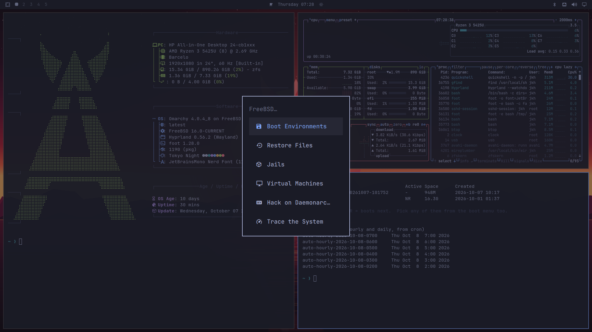
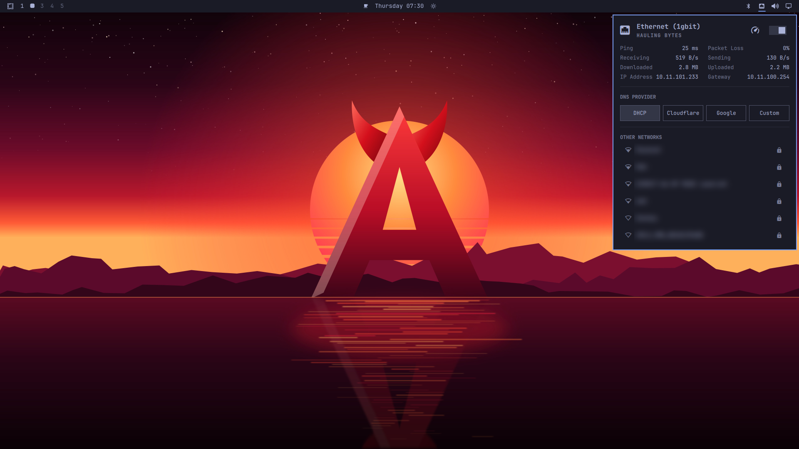
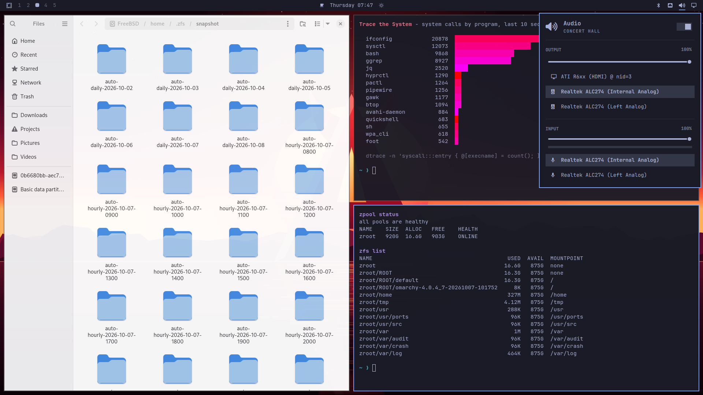

# Getting started with Daemonarchy

This guide takes you from a download to a working desktop, and through the things you will do in your first hour: get online, play sound, pair a keyboard, keep the system up to date, and use what FreeBSD adds. You do not need to know FreeBSD or Omarchy already.

Daemonarchy is the [Omarchy](https://omarchy.org) desktop running on [FreeBSD](https://www.freebsd.org). If you are curious how it is put together, or want to change it, read the [hacking guide](https://github.com/jordanhubbard/daemonarchy/blob/main/HACKING.md) when you are done here.

This guide describes Daemonarchy as it is on `main` for the next release, 1.5.0, which is not yet published. The [download page](https://github.com/jordanhubbard/daemonarchy/blob/main/README.md#download) identifies what is published, and each release's notes (for example the [1.4.1 release notes](release-1.4.1.md)) record its image, hardware status and outstanding qualification. Read them before choosing hardware. Where a feature arrived after the published release, this guide says so.

## What you need

- A 64-bit x86 PC with UEFI or legacy BIOS.
- A USB stick of 4 GB or more (the image is 3.5 GB once decompressed). Writing the image erases it.
- A disk or installation region of 40 GB or more. Whole-disk mode erases the selected disk. You can instead replace a selected GPT partition or use existing free space. The installer does not shrink filesystems; create space from the other operating system first.
- A network connection during installation. Wired Ethernet or personal Wi-Fi is the simplest path. On a MacBookPro16,1 the Broadcom Wi-Fi needs Apple firmware, which the installer acquires from Apple's recovery image or from local media before it changes the disk; without staged firmware, a temporary wired connection is needed to download it. The [enterprise Wi-Fi configuration](enterprise-wifi.md) is implemented, but real enterprise authentication remains unqualified.
- Graphics supported by the packaged FreeBSD drivers. The image includes NVIDIA drivers, and with an NVIDIA GPU the installer offers CUDA and cudalab (selected by default; it downloads them during the install). The MacBookPro16,1's Navi14 graphics reach a usable desktop. The MSI Raider 18 HX installs and runs the desktop (see its [1.4.0 results](hardware-quirks.md#140-on-this-machine)). QEMU with VirtIO/VirGL passes actual Hyprland checks. Read the [hardware quirks](hardware-quirks.md), especially the ASRock and T2 MacBook observations.

## 1. Download the image

Get the `.iso.xz` and matching `.sha256` from the [download page](https://github.com/jordanhubbard/daemonarchy/blob/main/README.md#download). GitHub **Latest** selects the newest stable release. Read its release notes (linked from the download page) before installing: publication does not establish physical-hardware compatibility or completion of the final installation matrix.

Checking the download is optional but quick. In a terminal, in the folder you saved both files to:

- macOS: `shasum -a 256 -c daemonarchy-*.iso.xz.sha256`
- Linux: `sha256sum -c daemonarchy-*.iso.xz.sha256`
- FreeBSD: `sha256 -c "$(cut -d' ' -f1 daemonarchy-*.iso.xz.sha256)" daemonarchy-*.iso.xz`
- Windows (PowerShell): `Get-FileHash daemonarchy-*.iso.xz`, then compare the result with the number in the `.sha256` file.

The image downloads xz-compressed as `daemonarchy-<version>-<arch>.iso.xz`, which is much smaller than the 3.5 GB image. Its `.iso.xz.sha256` file checks the compressed download, so use the same commands with `.iso.xz` in place of `.iso` (for example `sha256sum -c daemonarchy-*.iso.xz.sha256`).

## 2. Write it to a USB stick

The image is copied to the stick byte for byte; copying the file onto the stick like a document does not work.

- **Any system, the easy way:** [balenaEtcher](https://etcher.balena.io). Pick the `.iso.xz`, pick the stick, press Flash.
- **Windows:** [Rufus](https://rufus.ie) works too; when it asks, choose **DD image mode**.
- **macOS:** find the stick with `diskutil list` (say it is `/dev/disk4`), then `diskutil unmountDisk /dev/disk4` and `xz -dc daemonarchy-1.4.1-amd64.iso.xz | sudo dd of=/dev/rdisk4 bs=1m`.
- **Linux:** find the stick with `lsblk` (say `/dev/sdb`), then `xz -dc daemonarchy-1.4.1-amd64.iso.xz | sudo dd of=/dev/sdb bs=1M status=progress conv=fsync`.

balenaEtcher can flash the compressed file directly. For `dd`, decompress while writing instead of passing `if=`: `xz -dc daemonarchy-<version>-amd64.iso.xz | sudo dd of=/dev/rdisk4 bs=1m` on macOS, or `xz -dc daemonarchy-<version>-amd64.iso.xz | sudo dd of=/dev/sdb bs=1M status=progress conv=fsync` on Linux. FreeBSD and most Linux systems include `xz`; on macOS install it with Homebrew (`brew install xz`). If another tool will not accept the `.xz`, extract the `.iso` first, for example with [7-Zip](https://www.7-zip.org) on Windows.

Be sure of the device name: `dd` overwrites whatever you point it at.

## 3. Boot from the stick

1. Plug the stick in and turn the machine on, pressing its boot menu key (often F12, F11, F10 or Esc; on Macs hold Option).
2. Turn Secure Boot off, or [manually enroll the project certificate](secure-boot.md) for enforced Secure Boot, preserving existing OEM/Windows keys. Factory keys alone reject the project loader. 1.3.1 has a new certificate, so a machine that trusts only the 1.1 certificate needs the new one enrolled too. Earlier 1.0.1 needs Secure Boot off. aarch64 has no Secure Boot bundle.
3. Choose the USB stick. Use UEFI for Secure Boot; legacy BIOS boot also works.

### Try the live desktop first (x86-64 images since 1.4.0)

The installer image has offered a live desktop since 1.4.0; the 1.3.1 image has none and starts the text installer. The aarch64 image has no live desktop: it was not run there ([aarch64](aarch64.md)).

The loader menu that appears for a few seconds at boot is FreeBSD's own, with one entry added on the installer media (the installed system's menu does not have it). It offers **Try Daemonarchy (live desktop)**, which leaves the disk untouched. Press **T** there (any key first stops the countdown). Pressing Enter, or letting the countdown finish, starts the text installer as before.

The live desktop runs entirely from the stick and memory: it changes no disk, imports no existing ZFS pool and uses no swap. It is a minimal Hyprland session with a terminal (**Super + Enter**) and the graphical installer, which opens on its own (**Super + I** reopens it). It shows whether the desktop's graphics work on your machine. The graphics driver is chosen and loaded from the stick, so no network is needed for that. The full Omarchy desktop and its applications are only on the installed system.

The graphical installer asks the same questions as the text installer, checks them by the same rules and writes the same answers. Its network page runs the same network checks and shows what each one found; you can pick a different wired port as the primary connection, enter a DNS server, and set the clock by hand if network time does not answer. Nothing is written to a disk until you tick the confirmation on its last screen and press **Install Daemonarchy**; it then shows the installer's measured progress and offers a restart when the installation has verifiably completed. Enterprise (802.1X) Wi-Fi, setting the clock and the MacBook Wi-Fi firmware step open the text installer's own screens in a terminal window.

If the graphics cannot start, or when you leave the live desktop, the text installer takes over the screen; no disk has been changed. Everything the live desktop changes is kept in memory; its minimum memory has not been measured. Its account is named `live`, so choose a different user name for your installation.

## 4. Install

The installer asks a handful of questions, then installs on its own. Use the arrow keys, Tab and Enter.

1. **Welcome.** Press Enter to begin.
2. **Keyboard.** Pick your keyboard layout.
3. **Your account.** Your name, a user name, a password (you will log in with it, and give it when the system asks for your permission), a name for the computer, and your time zone.
4. **Network.** The installer lists your network adapters. A plugged-in cable is usually already connected; otherwise pick **Join Wi-Fi**, choose your network and type its password. You can also set an address by hand if your network has no DHCP. If the clock is wrong, choose **Set date and time** and enter the current UTC date and time; this works offline. **Synchronize time over network** tries NTP for up to 30 seconds. After either action the installer checks package access again. Package downloads still require internet access.

   Since 1.4.0 (not in the 1.3.1 image) the installer checks the network for you first, and each check takes at most a short, fixed time. The exact-image network matrix on physical hardware is not complete ([1.4.1 release notes](release-1.4.1.md)):
   - It lists every wired, USB-tethering and Wi-Fi adapter.
   - It asks all cabled ports for an address at once and uses the one whose gateway answers.
   - It checks DNS by looking up `pkg.FreeBSD.org` directly: first with your network's own servers, then with Cloudflare (1.1.1.1), Google (8.8.8.8) and Quad9 (9.9.9.9). It does not ping them, because some block ping.
   - It sets the clock from network time if the clock is wrong.
   - It loads any Wi-Fi firmware your adapter still needs.

   With no working cable, it gets Wi-Fi ready first and asks you to join a network. The results are listed on the **Network** screen.
   - **Use … as the primary connection** switches to another port that got an address.
   - **Enter a DNS server** is for networks that block public DNS. The installer uses the server only if it answers a lookup.
   - **Join Wi-Fi** lets you choose your network and type its password. **Set up … by hand** sets an address for networks without DHCP.
   - **Run network checks again** repeats the whole check.

   If your network's own DNS did not work, the installed system keeps the DNS servers that did. The check's log is in `/tmp/daemonarchy-network/log` (choose **Open debug shell** to read it).
5. **Remote access.** Say yes only if you want to log in to this machine from another one over SSH.
6. **Storage.** Pick the disk and installation mode, review the selected region, and choose whether to **encrypt** it. Encryption requires your password each time the machine starts. Earlier 1.0.1 supported whole-disk mode only.
7. **Ready.** Check the summary and confirm. Writes to the selected disk/partition/free region begin after confirmation.

The installer also offers optional `/usr/ports` and `/usr/src` Git checkouts. They download separately when selected and use the release's pinned revisions. Leave them off if you only want to run the desktop.

The desktop has roughly 1,200 packages; download and installation time depend on the selected release and connection. Wait for the explicit successful completion screen before removing the stick and restarting. An unexpected reboot is not that completion signal.

### While the installer works: extensions and games

The installer's options include an **Extensions** menu (also `x` on the progress screen, and `C-b e` in any tmux window). It lists what the signed Daemonarchy extension feed offers, with each entry's size and source, and downloads one only when you choose it. Four original arcade games (Hordeshot, Shatter, Rockdrift, Wyrm) are the first extensions, since 1.4.1. They run at low priority in their own window and stop at once when the installation finishes or fails or needs you. Nothing from the Extensions menu is installed onto your disk. The details are in [installer extensions](installer-extensions.md).

On main for the next release, extensions may also be written in Lua and run inside a sandbox ([sandboxed Lua extensions](sandboxed-extensions.md)), with a fish tank as the first. This is implemented and tested on a build host; the checks on a real installer image and real console (listed under "Not done yet" there) are not done, and the fish tank is not yet in the published feed.

## 5. Log in

At the login screen, type your password and press Enter. An encrypted installation can open the desktop automatically after the boot-time unlock. The first login takes a few seconds longer while your desktop is set up.

## 6. Find your way around

Everything starts from the keyboard. The key with the Windows or Command logo is called **Super**.

| Keys | What it does |
|---|---|
| Super + Space | The Daemonarchy menu: apps, settings, setup, updates, FreeBSD tools |
| Super + K | Every keyboard shortcut, searchable |
| Super + Return | Terminal |
| Super + Shift + B | Web browser |
| Super + Shift + F | Files |
| Super + W | Close the window |
| Super + 1 ... 9 | Switch workspace (Super + Shift + number moves the window there) |
| Super + T | Float or tile the window |
| Super + F | Full screen |
| Print Screen | Screenshot |
| Super + Ctrl + L | Lock the screen |
| Super + Escape | Log out, restart, shut down |

Windows tile themselves side by side as you open them; there is nothing to drag. The bar at the top shows your workspaces, the time, and icons for network, sound and Bluetooth: click one to open its panel.

## 7. Get online

Open the network panel with **Super + Ctrl + W**, or click the network icon in the bar.

- With a cable plugged in you are already online.
- For Wi-Fi, turn **Wi-Fi** on (the first time, this sets up your Wi-Fi card), pick a network, and type its password. Daemonarchy remembers it and reconnects by itself.
- To forget a network, highlight it and choose **Forget**.

A cable is enough. If a wireless card is present and no Wi-Fi switch appears, FreeBSD has no driver for that card.

Since 1.4.0 (not in the 1.3.1 image; not yet timed on hardware across a matrix) startup no longer waits on an unplugged or unanswered Ethernet port. The installed system waits at most 10 seconds for a network at startup (5 seconds when nothing is plugged in or joined) and uses the first connection whose router answers, preferring one whose DNS server also answers. A cable plugged in or a Wi-Fi network joined later is used as soon as it gets an address. If the connection in use goes down, another working one takes over. `daemonarchy-netselect status` shows which connection is in use, and `/var/log/daemonarchy-net.log` records each connection's result with the seconds since startup.

## 8. Sound

Open the sound panel with **Super + Ctrl + A**, or click the speaker icon. Pick where sound plays (speakers, headphones, HDMI) and which microphone records, and set the volume. The volume keys on your keyboard work as well.

## 9. Bluetooth devices

Open the Bluetooth panel with **Super + Ctrl + B**, or click the Bluetooth icon.

1. Turn Bluetooth on.
2. Put your keyboard or mouse into pairing mode (usually by holding its connect button until a light blinks).
3. Pick it from the list of devices found. Once paired it reconnects by itself.

Classic Bluetooth input devices are supported. Since 1.1 the desktop also has a native A2DP/SBC audio backend and output selection; real headset playback, reconnect/reboot and input-device regression checks remain unqualified. LE Audio and headset microphone profiles are outside this implementation. Use wired/USB audio while evaluating that support; see the [Bluetooth evidence](testing-1.1-bluetooth-audio.md).

## 10. Keep it up to date

Open the menu (**Super + Space**) and choose **Update**. Daemonarchy updates FreeBSD's packages and its own in one go, and before it changes anything it saves a **boot environment**: a snapshot of the whole system you can go back to if an update goes wrong (see below).

In a terminal, `daemonarchy update` uses the desktop update flow.
`sudo pkg upgrade` updates packages directly and does not create a boot
environment for you. Application-package upgrades do not migrate the FreeBSD
base/kernel or convert an old installation to Secure Boot. Verified installations
keep kernel-module packages locked to their signed snapshot. The 1.3.1 feed requires OSVERSION `1600029` in both the base system and kernel, with matching drivers; changing the feed URL alone does not perform that upgrade. 1.3.1 also signs its feeds with a new key, and no in-place upgrade from 1.1.1 is qualified: install 1.3.1 from the new image (see the [key rotation record](package-repository-key-rotation-1.3.1.md)). Use the documented
[signed maintenance workflow](secure-boot.md#update-and-recovery-contract) for protected boot updates.

Installations made with an older image need a one-time
[boot-root mount-policy check](https://github.com/jordanhubbard/daemonarchy/blob/main/HACKING.md#boot-environment-mount-policy)
before switching boot environments. Installations made with 1.1.1 or later set the correct
policy; an application-package update alone does not repair existing ZFS
dataset properties.

The desktop includes Chromium and the **OctoPkg** graphical package
manager. Choose **Install > Packages** or **Remove > Packages** to search,
install or remove FreeBSD packages; OctoPkg asks for administrator
authentication when it needs it. A new graphical package manager,
`daemonarchy-pkg` (a plan before every change, signed-repository display), is packaged on main for
the next release and listed for the application feed, but the menu still opens OctoPkg and it has not
been checked on a real desktop ([design and status](gui-package-manager.md)). The terminal package pickers remain
available as `daemonarchy pkg install` and `daemonarchy pkg remove`.

Use `daemonarchy --help` or `daemonarchy commands` to discover desktop
commands. For example, `daemonarchy update` runs Daemonarchy's update flow.
The desktop does not configure a local Docker engine, so it omits the stock
Docker application and Docker database/setup entries. Docker needs a Linux
VM or a separately configured remote engine on FreeBSD.

## 11. What FreeBSD adds

Open the menu and go to **System > FreeBSD**.

- **Boot Environments:** every update first saves a bootable copy of the system. If something breaks, pick an earlier one here (or from the boot menu at startup) and restart into it.
- **Restore Files:** your home folder is snapshotted every hour and every day. Browse a snapshot and copy back a file you deleted or changed by mistake.
- **Jails:** lightweight FreeBSD containers, each with its own packages, for trying things out without touching your system.
- **Virtual Machines:** run Linux, Windows or another BSD in a window, with bhyve.
- **Trace the System:** live views of what programs, files, disks and the network are doing, with DTrace.
- **Hack on Daemonarchy:** run the desktop from your own copy of its source code (see the [hacking guide](https://github.com/jordanhubbard/daemonarchy/blob/main/HACKING.md)).

## Windows programs and Steam (x86-64, next release)

On main for the next release the Apps menu has **Steam** and **Windows Programs** on x86-64: virtual apps, like Cudalab, that install Wine and its helpers from the system's repositories on first launch and download Valve's installer or Wine's Mono and DXVK components at that moment. Nothing of theirs is on the image. A game or Steam's window has not been run on the MSI Raider 18 HX or any other real desktop yet; the real first run was only checked headless on a build VM. See [Windows programs and Steam](windows-apps.md), whose Wine Mono and DXVK recipe was contributed by Sam Sheridan.

## 12. AI coding tools

Install available FreeBSD coding tools through **Install > Packages** or `pkg`. Daemonarchy does not offer upstream Omarchy’s automatic Linux agent downloads. Linux-only versions must pass version-specific Linuxulator testing before they can become release defaults.

## When something goes wrong

- **The machine will not boot the stick:** check the image/firmware mode and the [Secure Boot enrollment requirements](secure-boot.md). Check [known hardware blockers](hardware-quirks.md) before trying speculative loader changes.
- **The install stopped or restarted itself:** use the [rescue menu](rescue-console.md) to inspect the retained log and installation status before retrying. The live log is `/tmp/daemonarchy-install.log`; retained target evidence is `/var/log/daemonarchy-install.log` and `/var/db/daemonarchy/install`. Since 1.1.1, the integrity check refuses success when package files are missing or damaged. An unexpected reset is not evidence of completed installation; do not restart disk partitioning over the existing target to resume packages.
- **No rescue menu after boot messages:** since 1.1.1 the rescue console waits briefly for late probes and redraws the menu automatically. On an older image, pressing Return may redraw a menu that boot messages obscured. If pairing says another session is active, use **Unpair remote debugging agent** in rescue option 2, then **Pair** again.
- **A black screen after login in a VM:** the tested desktop path is QEMU with VirtIO/VirGL (in virt-manager, set the video model to Virtio). VirtualBox and QEMU's standard VGA or QXL adapters have no supported desktop driver; up to 1.3.1 that ended at a black screen with a cursor ([#88](https://github.com/jordanhubbard/daemonarchy/issues/88), [#89](https://github.com/jordanhubbard/daemonarchy/issues/89)). From 1.4 the installed system keeps the desktop off there and shows the [rescue menu](rescue-console.md) with the reason. Other virtual graphics configurations, including refreshed bhyve, remain unqualified. See the [VM graphics record](testing-1.1-vm-graphics.md).
- **An update broke something:** restart, choose an earlier boot environment in the boot menu, and you are back where you were.
- **Anything else:** [open an issue](https://github.com/jordanhubbard/daemonarchy/issues) with what you did and what you saw.

## Going further

- [The hacking guide](https://github.com/jordanhubbard/daemonarchy/blob/main/HACKING.md): how Daemonarchy is built, how to change it, and how to build your own image.
- The source: [daemonarchy](https://github.com/jordanhubbard/daemonarchy) (the installer), [daemonarchy-desktop](https://github.com/jordanhubbard/daemonarchy-desktop) (Daemonarchy's look and FreeBSD tools) and [omarchy-freebsd](https://github.com/jordanhubbard/omarchy-freebsd) (what lets Omarchy run on FreeBSD).
- [Omarchy's manual](https://learn.omacom.io/2/the-omarchy-manual) for desktop concepts and shortcuts. Use Daemonarchy's [FreeBSD application policy](freebsd-application-policy.md) for platform-specific software and commands.
- [The FreeBSD Handbook](https://docs.freebsd.org/en/books/handbook/) for the operating system underneath.
